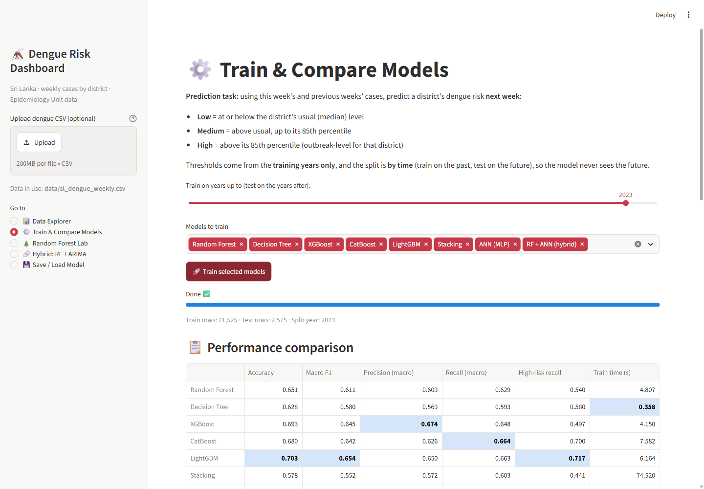

# Sri Lanka Dengue Outbreak Risk – Random Forest Dashboard

An interactive Streamlit dashboard. For each district of Sri Lanka, it predicts whether
dengue risk **next week** will be **Low, Medium or High** compared with that district's own
history. It compares a **Random Forest** with a single Decision Tree, gradient-boosting
ensembles (XGBoost, LightGBM, CatBoost), Stacking, a neural network (ANN), and two kinds of
hybrid model: **RF + ANN** and **RF + ARIMA**.

**Data:** weekly dengue cases by district, 2006–2025, from the Weekly Epidemiological
Reports of the Epidemiology Unit, Ministry of Health, Sri Lanka. The data was compiled in
the `denguedatahub` R package (v4.1.0).

**Live demo:** _add your Streamlit Community Cloud link here after deploying (see section 8)._



---

## 1. Project structure

```
dengue_dashboard/
├── app.py                      Streamlit dashboard (user interface, 5 pages)
├── ml_core.py                  Data cleaning, features, target, models, hybrids, save/load
├── convert_rda.py              Converts the R data file (.rda) to CSV
├── export_results.py           Re-creates everything in results/ and models/ without the UI
├── run_dashboard.bat           Windows: double-click to start the dashboard
├── requirements.txt            Python packages (pinned to the tested versions)
├── packages.txt                Linux system package for LightGBM (used by Streamlit Cloud)
├── .streamlit/config.toml      Streamlit settings (upload size limit, no usage stats)
├── README.md
├── LICENSE                     MIT licence (code)
├── data/
│   ├── srilanka_weekly_data.rda    Original data from the denguedatahub R package
│   └── sl_dengue_weekly.csv        The same data as CSV (used by the dashboard)
├── models/
│   └── dengue_lightgbm.pkl         Best model, ready to upload on the Save / Load page
├── results/
│   ├── model_comparison.csv        Scores of all 8 models
│   ├── hybrid_arima_comparison.csv ARIMA vs RF vs RF + ARIMA hybrids
│   └── next_week_predictions.csv   Next-week risk for each district (best model)
└── screenshots/                    One screenshot per dashboard page
```

## 2. How to run

Tested with **Python 3.13 on Windows 11**. **Python 3.12 or newer** is required, because the
pinned versions of numpy and streamlit have no packages for 3.11 or older.

```bash
cd dengue_dashboard
python -m venv venv
venv\Scripts\activate              # macOS / Linux: source venv/bin/activate
pip install -r requirements.txt
streamlit run app.py
```

The first time Streamlit runs on a computer it asks for an email address; just press
**Enter** to skip it.

On Windows, after the install you can also just double-click **`run_dashboard.bat`**. It
uses the venv automatically, skips the email question and opens the browser.

The dashboard opens at <http://localhost:8501> and loads `data/sl_dengue_weekly.csv`
automatically. Uploading another CSV in the sidebar replaces it. The CSV needs the columns
`year, week, district, cases`.

> **Windows PowerShell:** if `venv\Scripts\activate` is blocked ("running scripts is
> disabled"), skip activation and call the venv's Python directly:
> `venv\Scripts\python -m pip install -r requirements.txt` and then
> `venv\Scripts\python -m streamlit run app.py`.

**Re-create the results without the dashboard** (about 2 minutes):
```bash
python export_results.py            # writes results/*.csv and models/dengue_lightgbm.pkl
```

**Re-create the data from the original source** (optional; it is already in `data/`):
download `denguedatahub_4.1.0.tar.gz` from <https://cran.r-project.org/package=denguedatahub>,
extract `denguedatahub/data/srilanka_weekly_data.rda` into `data/`, and run
`python convert_rda.py`.

## 3. Dashboard pages

| Page | What it shows |
|---|---|
| 📊 **Data Explorer** | National weekly trend, total cases by district, seasonal pattern (monsoon), district × year heatmap, one-district view |
| ⚙️ **Train & Compare Models** | Shows pre-computed results for all 8 models until you train. Choose the split year and models, then see a comparison table, a bar chart per metric, a confusion matrix and feature importance. Stacking is not selected by default because it takes about 1 minute on its own; the other 7 models train in about 40 seconds. |
| 🌲 **Random Forest Lab** | Tune the number of trees, depth, leaf size, features per split and class balancing, and see the change against the default RF |
| 🔗 **Hybrid: RF + ARIMA** | ARIMA alone vs RF alone vs two RF + ARIMA hybrids, with adjustable ARIMA (p, d, q) and a forecast chart per district |
| 💾 **Save / Load Model** | Next-week risk for every district from the bundled LightGBM model (no training needed) or from any model trained in the session. Download any trained model as `.pkl`. Uploading a `.pkl` works only when run locally (see section 8). |

Train models on **Train & Compare** first. That page sets the train/test split used by
the Random Forest Lab, the Hybrid page and the Save page. The next-week predictions on the
Save / Load page work straight away with the bundled model.

## 4. Method

### Data
- The source file has **25,766 rows**: 26 reporting areas × 991 weeks (week 52 of 2006 to week 52 of 2025).
- The Epidemiology Unit reports by health area (RDHS). **Kalmunai** ("Kalmune" in the
  file) is a health area inside **Ampara district**, so its cases are added to Ampara.
  This gives Sri Lanka's **25 districts** (24,775 rows). Both areas report every week, so
  no week is incomplete.
- District spellings are standardised: *Hambanthota → Hambantota*, *NuwaraEliya → Nuwara Eliya*.
- All cleaning happens in `ml_core.load_raw`; the CSV itself is not changed.

### Features (`ml_core.build_features`): built only from the current and past weeks
| Feature | Meaning |
|---|---|
| `cases` | Cases this week |
| `lag_1 … lag_4` | Cases 1–4 weeks ago |
| `roll_mean_4`, `roll_mean_8`, `roll_max_4` | Recent trend |
| `roll_mean_52` | The district's normal level over the past year |
| `ratio_to_normal` | This week ÷ past-year normal |
| `diff_1` | Change since last week |
| `week`, `week_sin`, `week_cos`, `monsoon_code` | Season (SW monsoon May–Sep, NE monsoon Dec–Feb) |
| `district_code` | Which district |

### Target
Next week's cases in the same district, labelled by that district's own history:
**Low** (≤ median), **Medium** (≤ 85th percentile), **High** (> 85th percentile, outbreak level).
The thresholds are computed from the **training years only**.

### Train / test split
The split is **by time**: train on 2006–2023 and test on 2024–2025 (21,525 training rows,
2,575 test rows). A random split would let the model learn from later years and be
tested on earlier ones, which leaks future information.

### Metrics
Accuracy alone is misleading. A model that always predicts the most common class can look
accurate but never catches an outbreak. The main metric is **Macro F1**, the average F1 of
the three classes. **High-risk recall** is the share of real outbreak weeks the model catches.

### Models
| Model | Settings |
|---|---|
| Random Forest | 300 trees, max depth 12, min 2 samples per leaf, balanced class weights |
| Decision Tree | max depth 8, min 5 samples per leaf, balanced |
| XGBoost | 300 trees, depth 5, learning rate 0.05 |
| LightGBM | 300 trees, 31 leaves, learning rate 0.05, balanced |
| CatBoost | 300 iterations, depth 6, learning rate 0.08, balanced |
| Stacking | RF + Decision Tree + XGBoost + LightGBM, combined by Logistic Regression (5-fold) |
| ANN (MLP) | 2 hidden layers (64, 32), standardised inputs, early stopping |
| RF + ANN (hybrid) | Soft voting: averages the class probabilities of the RF and the ANN |

### RF + ARIMA hybrids (🔗 page)
An **ARIMA(2,1,1)** model is fitted for each district on log(1 + cases), using the
**training years only**. With those fixed parameters it makes one-step-ahead forecasts of
next week's cases, each using only earlier weeks. A check confirmed that the pipeline's
forecasts equal forecasts made by hand from data up to that week.

- **ARIMA only:** the forecast number of cases is converted to Low/Medium/High.
- **Hybrid 1, RF + ARIMA feature:** ARIMA's forecast is added as an extra feature for the RF.
- **Hybrid 2, ARIMA + RF residuals:** Zhang's (2003) residual-hybrid method, with a Random
  Forest in place of his neural network. ARIMA makes the forecast (the linear part), and an
  RF regressor learns ARIMA's errors (the non-linear part). The final forecast is ARIMA's
  forecast plus the RF correction.

All four are scored on the same test weeks. They also report **MAE**, the average error in
the forecast number of cases.

### Save / load (pickle)
The `.pkl` stores the model, feature list, district codes, risk thresholds, split year and
test scores, so a loaded model predicts exactly as it did when it was saved. Files saved
before the district clean-up, which used the raw names, are translated automatically when
loaded, so all 25 districts are still predicted.

## 5. Results

Split: train on 2006–2023, test on 2024–2025. These are the numbers in `results/`,
re-created by `python export_results.py`.

| Model | Accuracy | Macro F1 | High-risk recall | Train time (s) |
|---|---|---|---|---|
| **LightGBM** | **0.703** | **0.654** | **0.717** | 6.4 |
| XGBoost | 0.693 | 0.645 | 0.497 | 4.3 |
| CatBoost | 0.680 | 0.642 | 0.700 | 6.4 |
| Random Forest | 0.651 | 0.611 | 0.540 | 4.4 |
| Decision Tree | 0.628 | 0.580 | 0.580 | 0.3 |
| RF + ANN (hybrid) | 0.605 | 0.572 | 0.454 | 8.4 |
| Stacking | 0.578 | 0.552 | 0.441 | 63.1 |
| ANN (MLP) | 0.558 | 0.527 | 0.390 | 5.9 |

| RF + ARIMA comparison | Accuracy | Macro F1 | High-risk recall | MAE (cases) |
|---|---|---|---|---|
| **Hybrid 2: ARIMA + RF residuals** | **0.726** | **0.648** | 0.591 | **9.34** |
| ARIMA only | 0.724 | 0.646 | **0.640** | 9.52 |
| Random Forest only | 0.651 | 0.611 | 0.540 | – |
| Hybrid 1: RF + ARIMA feature | 0.649 | 0.609 | 0.540 | – |

Times are from one run on a laptop and will vary.

### Findings
- **Gradient boosting beats Random Forest.** LightGBM, XGBoost and CatBoost all score
  higher Macro F1 than the RF. LightGBM is the best model overall and also catches the
  most outbreak weeks (72%).
- **Random Forest is still a solid, stable baseline.** It beats the single Decision Tree,
  Stacking and the ANN, and needs no input scaling.
- **The ANN is the weakest model** on this tabular data. Adding it to the RF (RF + ANN)
  lowers the RF's score, which agrees with the usual finding that tree ensembles do better
  than neural networks on tabular data.
- **ARIMA is strong for this time-series task.** On its own it beats the RF. The classic
  residual hybrid (Hybrid 2) has a slightly higher Macro F1 and a lower forecast error (MAE)
  than ARIMA, but it catches fewer outbreak weeks (High-risk recall 0.591 vs 0.640).
  Giving ARIMA's forecast to the RF as a feature (Hybrid 1) does not help, most likely
  because the lag and rolling features already carry the same information.
- **Stacking performs worst among the ensembles.** Its inner 5-fold cross-validation
  ignores time order (see limitations).
- The most important RF features are this week's cases (`cases`), the district
  (`district_code`; each district has its own normal level), how unusual this week is
  (`ratio_to_normal`), and recent weeks (`lag_1`, `roll_max_4`, `roll_mean_4`).

## 6. Limitations
- Case counts depend on reporting, so some weeks may be under-reported or reported late.
- There is no weather data. District rainfall and temperature would be the natural next features.
- Stacking's inner 5-fold cross-validation is not time-aware, which probably explains its weak result.
- On the **training** rows, the ARIMA forecasts are in-sample, because ARIMA was fitted on
  those years. Both RF + ARIMA hybrids therefore learn from slightly optimistic ARIMA
  inputs. The **test** forecasts are genuinely out-of-sample.
- The RF + ARIMA hybrids are shown for comparison only and are not saved as `.pkl`.
- Risk levels shift over time. "Medium" weeks are 34% of the training rows but 63% of the
  test rows: 81% of test weeks were above their district's 2006–2023 median, compared with
  about half in training. Test scores therefore partly measure how well a model copes with
  that shift.
- Saved `.pkl` files load reliably only with the same package versions (see `requirements.txt`).
  Only open `.pkl` files you trust, because pickle can run code. For this reason `.pkl`
  upload is turned off unless the environment variable `ALLOW_PKL_UPLOAD=1` is set.

## 7. Data source and references
- **Data:** Talagala, T. S. *denguedatahub: A Tidy Format Datasets of Dengue by Country*,
  R package version 4.1.0 (CRAN, 2026). Licence GPL-3. <https://denguedatahub.netlify.app/>.
  Original source: Weekly Epidemiological Reports, Epidemiology Unit, Ministry of Health, Sri Lanka.
- Breiman, L. (2001). Random forests. *Machine Learning*, 45(1), 5–32.
- Chen, T., & Guestrin, C. (2016). XGBoost: A scalable tree boosting system. *Proc. KDD*.
- Ke, G. et al. (2017). LightGBM: A highly efficient gradient boosting decision tree. *NeurIPS*.
- Prokhorenkova, L. et al. (2018). CatBoost: Unbiased boosting with categorical features. *NeurIPS*.
- Zhang, G. P. (2003). Time series forecasting using a hybrid ARIMA and neural network
  model. *Neurocomputing*, 50, 159–175.

## 8. Deployment

### Streamlit Community Cloud (free, recommended)
1. Push this folder to a public GitHub repository (`venv/` is excluded by `.gitignore`).
2. Sign in at <https://share.streamlit.io> with GitHub and click **Create app** →
   **Deploy a public app from GitHub**.
3. Repository: your repo · Branch: `main` · Main file path: `app.py`.
4. Open **Advanced settings** and choose **Python 3.13**. The pinned packages need 3.12
   or newer. Leave the secrets box empty.
5. Click **Deploy**. The first build takes a few minutes (CatBoost, LightGBM, XGBoost).
   `packages.txt` installs `libgomp1`, which LightGBM needs on Linux.

Free apps go to sleep after a period with no visitors. The first visitor after that sees
a "wake up" button and waits about a minute.

### Security
`.pkl` upload is **off** on the deployed app, because a pickle file can run code on the
server. The bundled model and models trained in the session are used without any upload.
To turn upload on for local use only, set `ALLOW_PKL_UPLOAD=1`
(`run_dashboard.bat` does this). Do not set it on a public deployment.

## 9. Licence
The code is released under the [MIT License](LICENSE). The data in `data/` comes from the
`denguedatahub` R package and stays under its own licence (GPL-3); see section 7.

